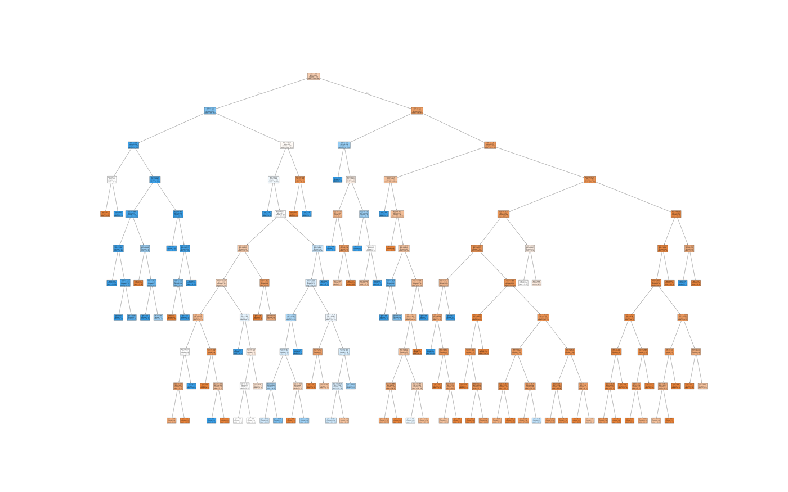

# 机器学习算法练习合集

整理自机器学习课程案例，覆盖 KNN、回归、决策树、随机森林、GBDT、XGBoost、朴素贝叶斯和 KMeans。

## Requirements

- Python 3.10+
- scikit-learn、XGBoost、pandas、matplotlib
- 依赖见 requirements.txt

## Installation

~~~bash
git clone https://github.com/Smasun0721/ml-practice.git
cd ml-practice
pip install -r requirements.txt
~~~

## Quick start

~~~bash
cd day06
python 电信客户流失预测.py
~~~

大多数脚本使用相对路径 ./data 或 ./resource，建议进入对应 day 目录后运行。

## Contents

| 目录 | 主题 | 代表案例 |
| --- | --- | --- |
| day01 | KNN 入门 | KNN 分类器、KNN 回归器 |
| day02 | 数据预处理与 KNN | 标准化/归一化、鸢尾花、手写数字识别 |
| day03 | 线性回归 API | 线性回归入门 |
| day04 | 线性回归实践 | 波士顿房价预测 |
| day05 | 分类评估 | 混淆矩阵、逻辑回归癌症预测 |
| day06 | 树模型入门 | 泰坦尼克号、电信客户流失预测 |
| day07 | 集成学习 | 回归决策树、随机森林、GBDT、葡萄酒分类 |
| day08 | 更多算法 | 朴素贝叶斯、KMeans、XGBoost 红酒品质 |
| day09 | 聚类评估 | SSE、轮廓系数、CH 指数、客户分群 |

## 结果示例

day06 泰坦尼克号案例的决策树可视化（由原脚本生成）：

## Project structure

~~~text
ml-practice/
├── day01/ ~ day09/
├── docs/
├── requirements.txt
└── README.md
~~~

## Notes

本仓库是机器学习课程练习合集，保留原始代码和目录结构；206MB 手写数字模型和 75MB 训练 CSV 未上传。数据和课程素材版权归原始提供方所有。
